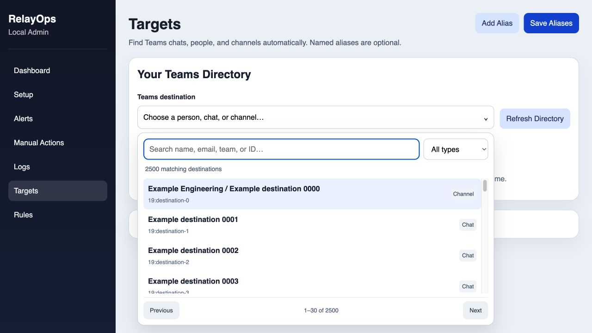

# RelayOps

**Give AI workflows a Teams destination.**

[](https://github.com/Ameer-Jamal/RelayOps/actions/workflows/ci.yml)
[](https://github.com/Ameer-Jamal/RelayOps/releases)
[](LICENSE)
[](package.json)

RelayOps is a local Teams automation app and MCP server. Let an AI assistant prepare a summary, review a pull request, or run a scheduled check, then deliver the result to the Teams destination you authorize. Discover existing chats and channels automatically; keep named aliases only where they help recurring rules.

[Get started](#get-started) · [Connect an AI](#connect-an-ai-client) · [Releases](https://github.com/Ameer-Jamal/RelayOps/releases) · [Architecture](docs/architecture.md) · [Contribute](CONTRIBUTING.md)



## What it does

- **Find destinations:** searchable dropdown with people/chat/channel filters, 30-result pages, keyboard selection, and server-side filtering. Thousands of destinations do not become thousands of DOM rows.
- **Work with AI:** eight MCP tools for discovery, sending, reading, authentication, status, and manual rule triggers.
- **Remember metadata locally:** account/profile-specific directory cache with a 15-minute refresh interval on demand. Message history is not stored in the directory cache.
- **Automate rules:** pull-request and unread-activity triggers, local alerts, templates, cooldowns, deduplication, and SQLite execution history.
- **See what happened:** local admin UI with health, configuration, rules, logs, and execution results.

For example, ask a connected assistant: “Review this PR, then send the summary to my Teams self-chat.” To deliver to another recipient, explicitly identify the recipient and purpose. Search first and resolve duplicate names before sending.

## Get started

Use **Node 22.22.2 or newer in the Node 22 release line**, Git, and a Teams work/school account. macOS and Linux core checks run in CI; Windows has not been validated for this release.

### From source

```sh
git clone https://github.com/Ameer-Jamal/RelayOps.git
cd RelayOps
npm ci
npx playwright install chromium
npm run build
npm start
```

Open **[localhost:4317](http://127.0.0.1:4317)**. Initial setup works without credentials. Copy `.env.example` to `.env` and `rules.example.yaml` to `rules.local.yaml` when you want local configuration files. Polling and startup Teams validation are disabled by default.

In **Manual Actions**, open/validate the Teams session and sign in through the dedicated browser window. Then open **Targets** to discover your accessible destinations. Use the dropdown to search by name, email, team, or conversation ID. Discovery sends no messages. The same picker is available when composing a manual test post.

### From a release

Download `RelayOps-vX.Y.Z.tar.gz` and `SHA256SUMS.txt` from [GitHub Releases](https://github.com/Ameer-Jamal/RelayOps/releases). Verify the checksum, extract the archive, and run inside its folder:

```sh
npm ci --omit=dev
npx playwright install chromium
npm start
```

The runtime archive already includes the compiled server and UI. It contains no installed dependencies, credentials, browser profile, or personal state. Native SQLite dependencies install for your own machine. GitHub also provides source archives for development.

## Connect an AI client

Build first when using a source checkout. Configure a local **stdio** MCP server using absolute paths:

```json
{
  "mcpServers": {
    "relayops": {
      "command": "/absolute/path/to/node",
      "args": ["/absolute/path/to/RelayOps/dist/mcp/index.js"]
    }
  }
}
```

For Codex CLI configuration:

```sh
codex mcp add relayops -- /absolute/path/to/node /absolute/path/to/RelayOps/dist/mcp/index.js
```

The server locates configuration from the RelayOps folder regardless of the client's working directory. Allow a tool timeout of **360 seconds** for sign-in/discovery. Direct Node execution keeps stdout clean for MCP; `npm run --silent mcp` also runs the compiled server. Use `npm run mcp:dev` during development. Reconnect the client after upgrading the server.

| Tool | Purpose |
| --- | --- |
| `teams_search_destinations` | Search/filter/page the account-specific directory; optionally refresh it |
| `teams_list_conversations` | List discovered destinations |
| `teams_list_targets` | List optional configured aliases |
| `teams_send_message` | Send plain text to an exact destination or alias |
| `teams_read_messages` | Read recent messages from a destination |
| `relayops_authenticate_teams` | Open/validate the browser session and capture authentication |
| `relayops_get_status` | Inspect runtime and authentication state |
| `relayops_run_trigger` | Execute a rule trigger with safeguards enabled by default |

`teams_search_destinations` accepts `query`, `kind` (`all`, `person`, `chat`, `channel`), `limit` (1–100), `offset`, and `refresh`. Use its returned `nextOffset` to continue. Resolve a name to its conversation ID before delivery if there are duplicates. Manual aliases override discovered names.

## Scheduling and rules

MCP provides tools; your AI client's scheduler decides when to use them. For an AI-generated daily report, configure a local scheduled task in the client that prepares the report, searches the intended recipient, and calls RelayOps to send it. The computer/client must be available and Teams authenticated. RelayOps's MCP process does not start polling rules or the admin server by itself.

RelayOps also has its own optional polling rules for `new_pr` and `unread_message`. Configure them in local rules and enable the scheduler deliberately. Cooldowns, execution keys, and SQLite history guard repeated actions. Manual trigger calls preserve guards unless `ignoreGuards: true` is explicitly requested.

Bitbucket integration uses your **Atlassian account email and a Bitbucket API token** with repository/pull-request read access. Set `RELAYOPS_BITBUCKET_USERNAME` and `RELAYOPS_BITBUCKET_APP_PASSWORD` respectively; those legacy environment names remain compatible. App passwords are no longer supported. A rejected credential is surfaced as an error, not “no PRs.” You can also use a local JSON PR feed; see [the configuration example](.env.example).

## Reliability and limits

Teams Web's newer bearer-authenticated Chat Service proxy and legacy regional Skype-token endpoints are supported. Read/discovery access has been verified in a work account, and a self-chat message was sent and read back. This release has not been live-tested by sending to other people or channels.

These are **internal Teams Web APIs** and can change. RelayOps does not register a Microsoft Graph application or bypass tenant policy. Discovery covers the signed-in user's conversation index, not every person/channel in the organization. A separate supported Graph integration would require its own app registration and consent.

Tokens expire and may require sign-in. Discovery distinguishes 401 authentication rejection, 403 access denial, and 429 throttling, paces reads, and respects bounded retry delays. A failed refresh retains the same account's cached data. Ambiguous names require an ID; bot chats and departed participants are not inferred to be self-chat. Uncertain API sends are not automatically resent.

Browser fallback still depends on Teams selectors. A live browser profile cannot be opened by two processes simultaneously. Keep the local admin server bound to `127.0.0.1`; see [Security](SECURITY.md) before connecting an AI client or exposing any service.

## Development and verification

```sh
npm run dev:all     # API + Vite UI
npm run verify     # typechecks, unit/MCP tests, build, browser tests
npm run release:package
```

Browser tests use isolated temporary state and **2,500 synthetic destinations**, never your Teams account. The release workflow reruns CI before publishing a compiled runtime archive and SHA-256 checksums. See [Contributing](CONTRIBUTING.md), [Changelog](CHANGELOG.md), and [Security](SECURITY.md).

Released under the [MIT license](LICENSE).
